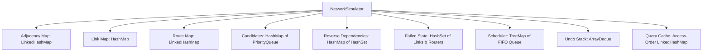

# Data Structures & Architecture Explanation
**Network Failure Simulation & Rerouting (Java Swing)**

---

## 1. Project Overview & Scope

This project simulates network router and link failures, dynamic failover to preconfigured backup routes, chronological event scheduling, and undo operations in a communication network.

### Important Scope Boundary (No Dijkstra / BFS / DFS)
As required for this college DSA project:
- **No pathfinding or graph traversal algorithms** (such as Dijkstra, Bellman-Ford, BFS, or DFS) are used.
- Instead, the simulator relies on **preconfigured routes** ranked by integer priority (where 1 is highest priority).
- When a router or link fails, the simulator uses **reverse dependency indexes** to identify affected routes in $O(1)$ time, marks them unavailable, and activates the highest-priority operational backup route.
- Link costs are preserved as topology metadata.

---

## 2. Core Classes & Responsibilities

| Class | Package | Purpose | Primary Data Structures Used |
|---|---|---|---|
| [`Link`](../src/main/java/com/networksim/model/Link.java) | `com.networksim.model` | Undirected edge between two routers with cost | Canonical sorting key (`a.compareTo(b)`) |
| [`Route`](../src/main/java/com/networksim/model/Route.java) | `com.networksim.model` | Preconfigured path (hop sequence + priority) | Immutable `List<String>` of router hops |
| [`NetworkEvent`](../src/main/java/com/networksim/model/NetworkEvent.java) | `com.networksim.model` | Scheduled or executed state change at a timestamp | Enum `Type`, integer timestamp, endpoint fields |
| [`NetworkSimulator`](../src/main/java/com/networksim/core/NetworkSimulator.java) | `com.networksim.core` | Core DSA engine for topology, routing, scheduling, undo | `LinkedHashMap`, `HashMap`, `HashSet`, `PriorityQueue`, `TreeMap`, `ArrayDeque` |
| [`NetworkPanel`](../src/main/java/com/networksim/ui/NetworkPanel.java) | `com.networksim.ui` | Visual canvas rendering topology, node/link states, active route | Java 2D Graphics, `LinkedHashMap` for node positions |
| [`NetworkGUI`](../src/main/java/com/networksim/ui/NetworkGUI.java) | `com.networksim.ui` | Main user interface with dynamic controls, validation, status bar | Swing components, combo boxes, text console |

---

## 3. Data Structures Used in the Project

The table below summarizes every major data structure, its code location, and complexity:



### 1. Adjacency List / Map (`LinkedHashMap<String, Map<String, Link>>`)
* **Real-World Analogy:** An address book where every city has a sub-list of directly connected neighboring cities and the highways between them.
* **Where it Appears:** [`NetworkSimulator.java`](../src/main/java/com/networksim/core/NetworkSimulator.java#L44)
* **Code Snippet:**
  ```java
  private final Map<String, Map<String, Link>> adjacency = new LinkedHashMap<>();

  public void addLink(String a, String b, int cost) {
      Link link = new Link(a, b, cost);
      adjacency.get(a).put(b, link);
      adjacency.get(b).put(a, link);
  }
  ```
* **Time Complexity:** $O(1)$ average lookup to check if router $B$ is a neighbor of router $A$.
* **Why Suitable:** A 2D matrix ($V \times V$) would waste space on sparse networks ($O(V^2)$ memory). A nested `Map` provides fast lookups while `LinkedHashMap` preserves predictable router insertion order for GUI rendering.

---

### 2. HashMap (`Map<String, Link>`, `Map<String, Route>`)
* **Real-World Analogy:** A library lookup desk where you give a book's call number and instantly receive the exact shelf location.
* **Where it Appears:** [`NetworkSimulator.java`](../src/main/java/com/networksim/core/NetworkSimulator.java#L47-L50)
* **Code Snippet:**
  ```java
  private final Map<String, Link> links = new HashMap<>();
  private final Map<String, Route> routes = new LinkedHashMap<>();
  ```
* **Time Complexity:** $O(1)$ average time for insertion, retrieval, and deletion.
* **Why Suitable:** Finding whether link `"A|B"` exists using an `ArrayList` takes $O(E)$ linear time. `HashMap` allows instant $O(1)$ lookups using hash codes.

---

### 3. HashSet (`Set<String> failedRouters`, `Set<String> failedLinks`)
* **Real-World Analogy:** A security blacklist badge scanner at an entrance. If an ID is on the blacklist, entry is instantly denied.
* **Where it Appears:** [`NetworkSimulator.java`](../src/main/java/com/networksim/core/NetworkSimulator.java#L65-L68)
* **Code Snippet:**
  ```java
  private final Set<String> failedLinks = new HashSet<>();
  private final Set<String> failedRouters = new HashSet<>();

  boolean changed = fail ? failedLinks.add(key) : failedLinks.remove(key);
  if (!changed) {
      throw new IllegalStateException("Link already " + (fail ? "FAILED" : "OPERATIONAL"));
  }
  ```
* **Time Complexity:** $O(1)$ average time for `contains()`, `add()`, and `remove()`.
* **Why Suitable:** A route hop validation checks if any router or link is down. With `HashSet`, checking if a router is down is $O(1)$. It also inherently rejects duplicate failure registrations.

---

### 4. PriorityQueue (`PriorityQueue<Route>`)
* **Real-World Analogy:** Hospital triage or emergency dispatch, where patients/calls are prioritized by severity (highest priority served first).
* **Where it Appears:** [`NetworkSimulator.java`](../src/main/java/com/networksim/core/NetworkSimulator.java#L53)
* **Code Snippet:**
  ```java
  private final Map<String, PriorityQueue<Route>> candidates = new HashMap<>();

  candidates.computeIfAbsent(route.pair(), k -> new PriorityQueue<>(
      Comparator.comparingInt(Route::priority).thenComparing(Route::id)
  )).add(route);
  ```
* **Time Complexity:** $O(\log K)$ insertion, where $K$ is candidate routes per pair; $O(1)$ peek at the top priority route.
* **Why Suitable:** Instead of sorting candidate routes repeatedly whenever a failure occurs, the binary min-heap maintains routes ordered by priority automatically.

---

### 5. TreeMap (`TreeMap<Integer, Queue<NetworkEvent>>`)
* **Real-World Analogy:** A calendar agenda organized strictly by date and time. You can instantly see the earliest scheduled appointment.
* **Where it Appears:** [`NetworkSimulator.java`](../src/main/java/com/networksim/core/NetworkSimulator.java#L71)
* **Code Snippet:**
  ```java
  private final TreeMap<Integer, Queue<NetworkEvent>> scheduled = new TreeMap<>();

  public void schedule(int timestamp, NetworkEvent.Type type, String a, String b) {
      scheduled.computeIfAbsent(timestamp, t -> new ArrayDeque<>()).add(event);
  }
  ```
* **Time Complexity:** $O(\log T)$ for inserting an event or finding the next earliest timestamp, where $T$ is the number of distinct timestamps (backed by a Red-Black self-balancing binary search tree).
* **Why Suitable:** Unlike a `HashMap` (which has no ordering) or an unsorted list (which requires $O(N)$ scanning to find the minimum time), `TreeMap.firstEntry()` gives the earliest event in $O(\log T)$ time.

---

### 6. Queue (`Queue<NetworkEvent>` via `ArrayDeque`)
* **Real-World Analogy:** A queue of customers at a ticket counter. The first customer to join the line at 10:00 AM is served first (FIFO — First-In, First-Out).
* **Where it Appears:** Inside the `TreeMap` values in [`NetworkSimulator.java`](../src/main/java/com/networksim/core/NetworkSimulator.java#L71)
* **Code Snippet:**
  ```java
  Queue<NetworkEvent> queueAtTimestamp = earliestEntry.getValue();
  NetworkEvent eventToExecute = queueAtTimestamp.remove(); // FIFO poll
  ```
* **Time Complexity:** $O(1)$ amortized insertion (`add`) and removal (`remove`).
* **Why Suitable:** Multiple events can be scheduled at the exact same simulation clock time (e.g. failing router B and link E-F at $t=10$). Using a FIFO Queue under each timestamp key ensures events scheduled at the same second run in deterministic arrival order.

---

### 7. ArrayDeque as a LIFO Stack (`Deque<NetworkEvent> undoStack`)
* **Real-World Analogy:** A stack of plates or the "Ctrl+Z" feature in a text editor: the most recent action is on top and is reversed first.
* **Where it Appears:** [`NetworkSimulator.java`](../src/main/java/com/networksim/core/NetworkSimulator.java#L74)
* **Code Snippet:**
  ```java
  private final Deque<NetworkEvent> undoStack = new ArrayDeque<>();

  // Pushing inverse event:
  undoStack.push(new NetworkEvent(clock, NetworkEvent.Type.RESTORE_LINK, a, b));

  // Undoing:
  NetworkEvent inverse = undoStack.pop();
  applyEvent(inverse, false);
  ```
* **Time Complexity:** $O(1)$ `push()` and `pop()`.
* **Why Suitable:** `ArrayDeque` is the recommended, high-performance modern replacement for legacy `java.util.Stack`. It does not suffer from synchronization overhead.

---

### 8. Bounded LRU Cache (`LinkedHashMap<String, String>`)
* **Real-World Analogy:** A desk workspace that holds only the 32 most recently referenced reference cards. When space runs out, the card not touched for the longest time is discarded.
* **Where it Appears:** [`NetworkSimulator.java`](../src/main/java/com/networksim/core/NetworkSimulator.java#L80-L85)
* **Code Snippet:**
  ```java
  private final LinkedHashMap<String, String> cache = new LinkedHashMap<>(16, 0.75f, true) {
      @Override
      protected boolean removeEldestEntry(Map.Entry<String, String> eldest) {
          return size() > 32;
      }
  };
  ```
* **Time Complexity:** $O(1)$ for query cache lookups, insertions, and evictions.
* **Why Suitable:** Repeated route status queries for the same pair (e.g. `"A->D"`) return instantly without string formatting overhead. Because `accessOrder=true`, accessing an entry moves it to the tail. If the map exceeds 32 entries, the oldest unused entry is automatically pruned. Any link/router state change clears the cache.

---

### 9. Reverse Dependency Indexes (`Map<String, Set<String>>`)
* **Real-World Analogy:** An index at the back of a textbook: instead of reading all 500 pages to find where "Router B" is discussed, you look up "Router B" in the index and jump directly to pages {R1, R3}.
* **Where it Appears:** [`NetworkSimulator.java`](../src/main/java/com/networksim/core/NetworkSimulator.java#L56-L59)
* **Code Snippet:**
  ```java
  // Inverted index: Link key -> Set of route IDs using this link
  private final Map<String, Set<String>> linkDeps = new HashMap<>();
  // Inverted index: Router ID -> Set of route IDs using this router
  private final Map<String, Set<String>> routerDeps = new HashMap<>();
  ```
* **Time Complexity:** $O(1)$ lookup to retrieve all affected route IDs upon a failure, rather than iterating through all routes in the system ($O(R \times H)$).
* **Why Suitable:** In large routing tables with thousands of preconfigured routes, inspecting every route whenever a single link fails would be prohibitively slow ($O(R)$). The reverse index allows immediate $O(1)$ identification of affected paths.

---

## 4. Viva / Interview Questions & Quick Answers

1. **Q: Why does this project not use Dijkstra's Algorithm?**
   * **A:** Real-world carrier networks (such as MPLS Fast Reroute) often use precomputed, preconfigured primary and backup paths for deterministic failover latency. This DSA project focuses on data structure organization (hash sets, reverse dependency indexes, heaps, trees, queues, stacks) to manage preconfigured route priorities rather than runtime graph discovery.

2. **Q: What happens when link B-C fails?**
   * **A:** The link key `"B|C"` is added to `failedLinks`. The simulator consults `linkDeps.get("B|C")`, which returns route `R1`. `R1` is marked unavailable. The simulator reevaluates candidate routes for pair `"A->D"` from its `PriorityQueue` and selects `R2: A -> E -> F -> D` (Priority 2) as active.

3. **Q: How does the scheduler handle past timestamps or equal timestamps?**
   * **A:** The simulator tracks a simulation clock $t$. Any event scheduled with $t < clock$ is rejected with an exception and UI alert. Events scheduled at the exact same timestamp are placed into a FIFO `Queue` (`ArrayDeque`) stored under that timestamp in the `TreeMap`.
